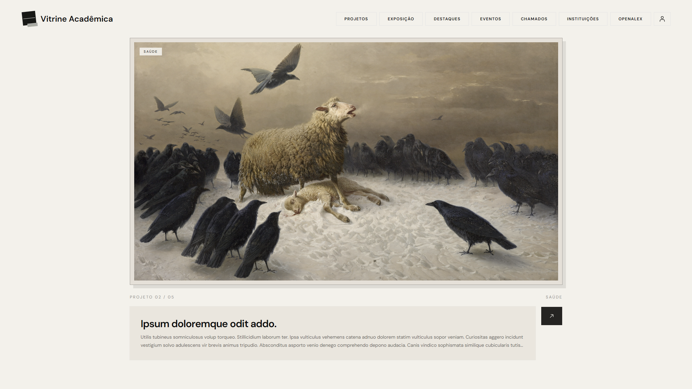

# Vitrine Acadêmica

Galeria virtual de projetos acadêmicos. A plataforma está em [vitrineacademica.com](https://vitrineacademica.com).

## O que é

A Vitrine Acadêmica é uma plataforma digital para divulgação e descoberta de projetos acadêmicos. Ela aproxima pessoas interessadas em colaborar, organiza chamadas e candidaturas, reúne avaliações de trabalhos, permite acompanhar autores, consultar pesquisas científicas e realizar eventos e atividades institucionais.

É um ambiente de divulgação e interação. A plataforma não certifica a validade acadêmica dos trabalhos e não substitui os regulamentos de cada instituição.

## Recursos

- **Projetos.** Cadastro com anexos e tags, nos estados de rascunho, agendado, publicado e arquivado. A publicação pode ser imediata ou marcada para uma data.
- **Exposição.** Galeria dos projetos publicados no dia e dos agendados para os próximos sete dias.
- **Destaques.** Curadoria da banca, a partir de avaliações docentes por critérios, e da comunidade, a partir de estrelas.
- **Chamados.** Publicação de demandas, candidaturas e decisão. Um chamado encerrado pode originar um projeto.
- **Instituições.** Páginas institucionais, membros e solicitações de vínculo, com análise de aprovação ou rejeição.
- **Eventos.** Ciclo com sugestão e moderação de temas, votação, seleção institucional, inscrições de projetos e encerramento.
- **Pontos e promoções.** Saldo usado para destacar projetos na vitrine.
- **Newsletter.** Acompanhamento de autores, com aviso por e-mail quando um novo projeto é publicado.
- **Pesquisas científicas.** Busca de trabalhos na OpenAlex.
- **Administração.** Painel com métricas de projetos, usuários, instituições e tags.
- **Conta.** Acesso por código temporário enviado ao e-mail cadastrado, sem senha. O usuário pode exportar os próprios dados e excluir a conta.

## Papéis

A conta tem um papel global: `USER`, `STUDENT`, `PROFESSOR` ou `ADMIN`, definidos em [`packages/permissions/src/roles.ts`](packages/permissions/src/roles.ts). Usuário lê projetos e instituições. Estudante e professor também criam projetos e alteram os próprios. Administrador gerencia a plataforma.

O vínculo com uma instituição é independente desse papel. Dentro da instituição, o membro pode ser estudante, professor, docente, gestor ou secretaria. Gestor e secretaria administram a instituição; docente e professor participam da avaliação de trabalhos.

As regras de autorização ficam no pacote compartilhado `@vitrine-academica/permissions`, com [CASL](https://casl.js.org/).

## Arquitetura

O repositório é um monorepo com pnpm e Turborepo.

A API segue camadas de domínio, aplicação e infraestrutura. Casos de uso e entidades ficam em `apps/api/src/domain`; HTTP, persistência e jobs ficam em `apps/api/src/infra`. O servidor é Fastify, com validação Zod, e persiste em PostgreSQL via Drizzle ORM. A documentação da API é exposta com Swagger.

O frontend é uma aplicação Next.js com App Router. As páginas autenticadas consultam a API no servidor e guardam a sessão em cookie.

Jobs periódicos publicam projetos agendados, avançam as fases dos eventos, encerram chamados com prazo vencido, expiram promoções e enviam os avisos pendentes da newsletter.

## Tecnologias

**Web** (`@vitrine-academica/web`): Next.js 16, React 19, Tailwind CSS 4, shadcn e Base UI, TanStack Query, nuqs, Recharts e ky.

**API** (`@vitrine-academica/api`): Fastify 5, Drizzle ORM, PostgreSQL, JWT e cookies, Vitest para testes de domínio e de integração HTTP.

**Compartilhado:** TypeScript, Zod, Biome e o pacote de permissões.

**Integrações:** Cloudflare R2 para anexos, Resend para e-mail e OpenAlex para a busca de trabalhos científicos.

## Repositório

- `apps/web` — interface da galeria, das instituições, dos eventos e da conta.
- `apps/api` — API, domínio, banco e jobs.
- `packages/permissions` — papéis e habilidades usados pela API e pelo frontend.
- `config/typescript-config` — configuração de TypeScript do monorepo.
